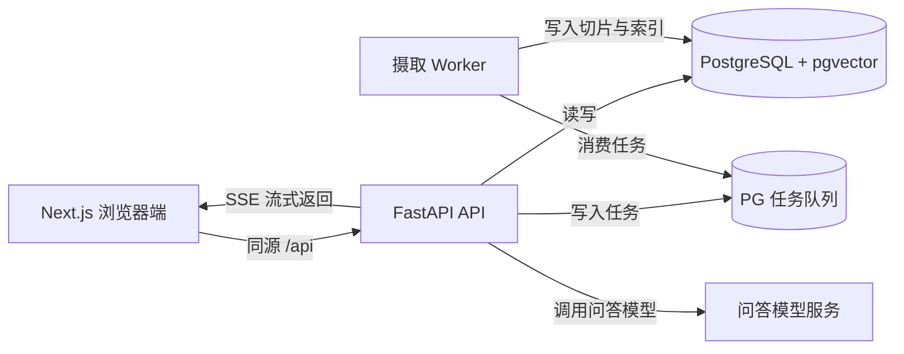
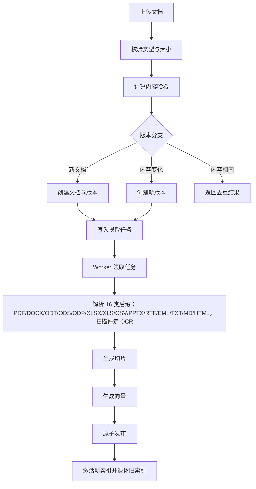

# 架构说明

PyKnora 是一个多租户可信 RAG 知识库系统。它重点解决四类问题：

1. 文档版本与可检索切片保持一致。
2. 语义检索和关键词检索混合使用，同时不把两种分数当作可直接比较的分数。
3. 回答可追溯，证据不足时拒答。
4. 工作区隔离，跨租户访问与资源不存在返回一致的 404 语义。

## 系统视图



## 后端分层

| 层级 | 位置 | 职责 |
| --- | --- | --- |
| API 层 | `src/pyknora/api/` | 请求校验、依赖注入、统一错误信封、SSE |
| 服务层 | `src/pyknora/services/` | 摄取、检索、问答、队列、身份权限、血缘、迁移 |
| 仓储层 | `src/pyknora/db/repos/` | SQL 访问；活动切片读取走 `v_active_chunks` |
| 模型层 | `src/pyknora/models/` | SQLAlchemy 表映射 |
| 契约层 | `src/pyknora/schemas/` | Pydantic 请求、响应与事件契约 |
| Worker | `src/pyknora/workers/` | 独立摄取进程 |
| 迁移 | `migrations/` | 只追加的编号 SQL 文件 |

## 核心链路

### 文档摄取



发布动作在同一个数据库事务里完成：旧索引退休、新索引激活、文档指针切换和任务完成一起生效。这样可以避免“新切片已写入但旧内容仍可检索”的中间状态。

### 检索与问答

- `/query` 同时执行向量检索和 PostgreSQL 全文检索，再用 Reciprocal Rank Fusion（RRF）融合排序。
- `/chat` 使用 SSE 流式返回，事件顺序为 `retrieval` → `token*` → `done`。
- 回答前先做证据校验；证据不足时拒答，而不是编造答案。
- 引用会指向文档、页码区间和当前活动版本。

## 多租户隔离

- 身份来自服务端校验的 JWT 或会话上下文，不信任请求体中的身份字段。
- 每次请求都会重新解析 workspace membership。
- PostgreSQL Row-Level Security 在应用层校验之下再提供一层兜底。
- 跨租户访问返回与“资源不存在”一致的 404 语义，避免暴露资源是否存在。
- 权限校验集中在 API 依赖层，而不是分散在各个路由里。

## 工程不变量

1. **可读切片来自活动索引。** 常规读取必须走 `v_active_chunks`。
2. **发布是原子事务。** 旧索引退休、新索引激活和文档指针切换必须一起完成。
3. **向量维度不允许截断。** 维度不一致必须直接报错。
4. **迁移只追加。** 已合并的迁移文件不修改历史。
5. **切片偏移可回溯原文。** 纯文本切片的字符偏移必须能对应回源文本。
6. **错误使用统一信封。** API 失败统一返回 `{ error, request_id }`。

## 可观测性

三层分工，各回答一类问题：

| 层 | 回答什么 | 实现 |
| --- | --- | --- |
| 事件日志 | 这一次请求具体发生了什么 | `core/logging.py` 的 `log_event`，结构化字段 + 上下文里的 `request_id` |
| 指标 | 过去一段时间里各类结果各出现了多少次 | `core/metrics.py` 的进程内计数器，`GET /metrics` 用 Prometheus 文本格式导出 |
| 关联键 | 同一次请求的日志与响应怎么对上 | `request_id` 贯穿 SSE 与错误信封 |

指标刻意保持一屏可读完（10 个，都是计数或 gauge）：

- 检索：`pyknora_retrieval_requests_total{strategy,outcome}`、`pyknora_retrieval_branch_degraded_total{branch,code}`
- 门控：`pyknora_gate_verdict_total{verdict}`、`pyknora_gate_refusals_total{reason}`
- 问答：`pyknora_chat_runs_total{status}`、`pyknora_embedding_dimension_errors_total{provider}`
- 队列与自检：`pyknora_queue_jobs{status}`、`pyknora_build_info{env,version}`、`pyknora_metrics_scrape_errors_total{collector}`、`pyknora_metrics_errors_total{op}`

三条约束，都是"以后加埋点时不要破坏"的：

1. **标签只能取自代码里的枚举。** `metrics.py` 维护每个指标的标签白名单，未声明的标签名或取值直接抛 `ValueError`；`None` 表示开放取值但有格式与长度上限。理由是基数：一次请求的 query、文档名、chunk id 一旦进标签，序列数就随流量增长，抓取端先崩。
2. **计数只在进程内。** api 与 worker 是两个容器两个进程，worker 的计数不会出现在 api 的 `/metrics` 上；队列状态是抓取时查库（2 秒超时，失败记 `scrape_errors`），所以跨进程有效。其余跨进程的事实以事件为准。
3. **埋点不得改变控制流。** 一律走 `safe_inc` / `safe_set`，内部吞掉异常并计入 `pyknora_metrics_errors_total`；指标出错不能打断一次问答。

不做延迟直方图：`retrieval_ms`、`evidence_check_ms`、`model_ttft_ms` 已经写在 `chat_finished` 事件里，延迟的聚合口径归离线评测，进程内再维护一套直方图只会多一份对不上的数。

## 前端

前端使用 Next.js App Router，主要包括：

- React 19 与 TypeScript。
- TanStack Query 管理服务端状态。
- Tailwind CSS 与设计令牌。
- 以后端 OpenAPI 快照为基准的契约测试。
- Vitest 组件与契约测试，Playwright 端到端测试。

详见 [`web/README.md`](./web/README.md)。

## 测试

测试按耦合程度分层：

| 层级 | 目的 |
| --- | --- |
| `tests/unit` | 纯逻辑测试，不需要数据库 |
| `tests/contract` | 跨模块契约测试 |
| `tests/api` | FastAPI 通过 ASGI 调用真实 PostgreSQL |
| `tests/integration` | 数据库行为、RLS、队列与迁移路径 |

在仓库根目录运行：

```bash
uv run pytest -q tests/unit
uv run pytest -q tests/contract
uv run pytest -q tests/api
uv run pytest -q tests/integration
```
