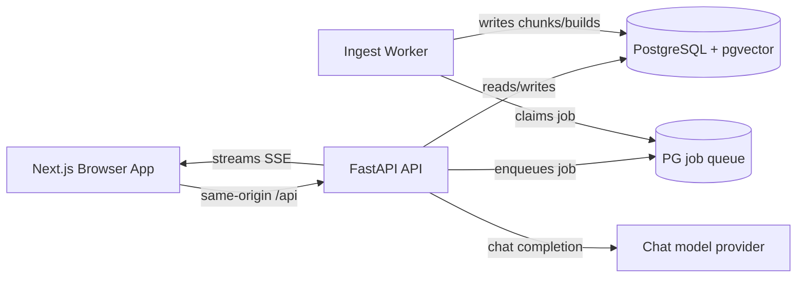
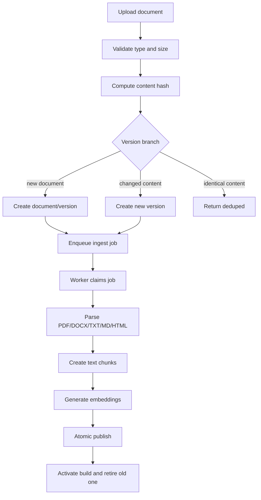

# Architecture

PyKnora is a multi-tenant Retrieval-Augmented Generation (RAG) knowledge base. It focuses on four hard problems:

1. Keeping document versions and searchable chunks consistent.
2. Mixing semantic and keyword retrieval without pretending scores are comparable.
3. Making answers traceable and refusing when evidence is insufficient.
4. Isolating workspaces so cross-tenant access is indistinguishable from a missing resource.

## System view



## Backend layers

| Layer | Location | Responsibility |
| --- | --- | --- |
| API | `src/pyknora/api/` | HTTP validation, dependency injection, unified errors, SSE |
| Services | `src/pyknora/services/` | Ingestion, retrieval, RAG answer, queue, auth, lineage, migration |
| Repositories | `src/pyknora/db/repos/` | SQL access; active-chunk reads go through `v_active_chunks` |
| Models | `src/pyknora/models/` | SQLAlchemy row mappings |
| Schemas | `src/pyknora/schemas/` | Pydantic request/response/event contracts |
| Workers | `src/pyknora/workers/` | Long-running ingestion process |
| Migrations | `migrations/` | Append-only numbered SQL files |

## Core data flow

### Ingestion



The publication step is transactional: the old build is retired, the new build is activated, document pointers are updated, and the job completes in the same database transaction.

### Retrieval and chat

- `/query` performs vector and PostgreSQL full-text search, then fuses results with Reciprocal Rank Fusion (RRF).
- `/chat` streams Server-Sent Events: `retrieval` → `token*` → `done`.
- Evidence is checked before answering. When evidence is insufficient, the system abstains instead of inventing an answer.
- Citations identify the document, page range and active version that supported the answer.

## Multi-tenancy

- Identity comes from JWT/session context, not from user-supplied request fields.
- Workspace membership is resolved on each request.
- PostgreSQL Row-Level Security provides a second containment layer.
- Cross-tenant access returns the same `404` shape as a missing resource, avoiding existence leakage.
- Permission checks are centralized in API dependencies.

## Engineering invariants

1. **Readable chunks come from the active build.** Normal reads use `v_active_chunks`.
2. **Publishing is atomic.** Old build retirement, new build activation and document pointer updates happen together.
3. **Vector dimensions are never truncated.** Dimension mismatch is an error.
4. **Migrations are append-only.** Existing migration files are not rewritten.
5. **Chunk offsets preserve source text.** Plain-text chunks can be mapped back to the source range.
6. **Errors use one envelope.** API failures return `{ error, request_id }`.

## Frontend

The web app is a Next.js App Router client with:

- React 19 and TypeScript.
- TanStack Query for server state.
- Tailwind CSS with design tokens.
- Contract tests against the backend OpenAPI snapshot.
- Vitest component/contract tests and Playwright end-to-end tests.

See [`web/README.md`](./web/README.md) for frontend commands and structure.

## Testing

Tests are split by coupling:

| Layer | Purpose |
| --- | --- |
| `tests/unit` | Pure logic, no database |
| `tests/contract` | Cross-module contracts |
| `tests/api` | FastAPI via ASGI against a real PostgreSQL database |
| `tests/integration` | Database-level behaviour, RLS, queue and migration paths |

Run from the repository root:

```bash
uv run pytest -q tests/unit
uv run pytest -q tests/contract
uv run pytest -q tests/api
uv run pytest -q tests/integration
```
